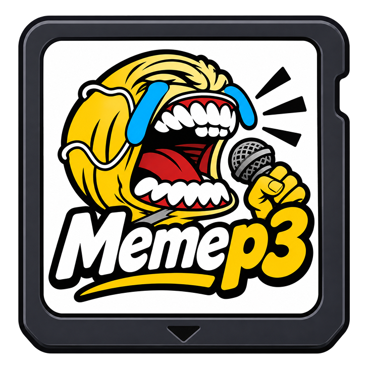

<div align="center">



# MemeP3

**Crie figurinhas para o WhatsApp a partir de imagens, GIFs e vídeos. Recorte, enquadre e experimente com som.**

[**Abrir editor**](https://memep3.vercel.app/) · [Wiki](wiki/README.md) · [Design no Figma](https://www.figma.com/design/WKxiDUIB4OApWJkoQd0gTw/memep3?node-id=0-1) · [Reportar problema](https://github.com/erickpxd/memep3/issues)

**Português (BR)** · [English](wiki/readme/README.en.md) · [Español](wiki/readme/README.es.md) · [Français](wiki/readme/README.fr.md)

</div>

## O que dá para fazer

- Use imagens PNG, JPG e WebP, GIFs animados e vídeos MP4, MOV e WebM, conforme os codecs do navegador.
- Escolha um trecho de até 10 segundos e ajuste o enquadramento quadrado arrastando e redimensionando a mídia.
- Mantenha o som do vídeo, importe um áudio, grave pelo microfone ou crie uma figurinha sem áudio. A prévia permite conferir o recorte e a sincronização.
- Exporte figurinhas WebP estáticas ou animadas, vídeos com áudio em MP4 ou WebM e pacotes `.memep3pack` para os apps móveis.

## Onde usar

| Plataforma | O que oferece |
| --- | --- |
| **Web** | Editor no navegador, com processamento local dos arquivos. [Abrir o MemeP3](https://memep3.vercel.app/) |
| **Chrome e Edge** | O mesmo editor em uma extensão, com importação de áudio do MyInstants. [Instalar a extensão localmente](wiki/desenvolvimento.md#extensão-do-chrome-e-edge) |
| **Android e iPhone** | Apps complementares para adicionar pacotes sem áudio no WhatsApp. [Compilar os apps](wiki/desenvolvimento.md#app-android) |

## Criar e salvar no WhatsApp

1. Selecione, cole ou arraste um arquivo para o editor.
2. Ajuste o enquadramento, o trecho e o áudio. Confira a prévia e gere o resultado.
3. Use **Baixar** para guardar o arquivo ou **Salvar no WhatsApp** para iniciar o fluxo disponível no seu dispositivo.

No Android, com o app MemeP3 instalado, **Salvar no WhatsApp** baixa o WebP e abre o importador. O app reúne três figurinhas diferentes do mesmo tipo em um pacote. No computador ou iPhone, o editor pode reunir de 3 a 30 figurinhas do mesmo tipo em um arquivo `.memep3pack` para abrir no app móvel. A adição termina com a confirmação no WhatsApp. [Guia de importação](wiki/whatsapp.md)

Para usar o áudio, baixe a versão em vídeo e selecione-a em **Figurinhas → Criar** no WhatsApp. A opção de manter o áudio depende da disponibilidade do ícone de som na sua conta.

## Formatos de saída

| Formato | Uso |
| --- | --- |
| **WebP estático** | Figurinha sem áudio de 512 × 512 px e até 100 KB. |
| **WebP animado** | Figurinha sem áudio de 512 × 512 px, até 500 KB e até 10 segundos. |
| **MP4 ou WebM** | Vídeo com o áudio editado. O formato depende dos codecs disponíveis no navegador. |
| **`.memep3pack`** | Pacote local com figurinhas estáticas ou animadas para importar no app MemeP3. |

## Desenvolvimento

Requer Node.js 22 ou superior.

```sh
git clone https://github.com/erickpxd/memep3.git
cd memep3
npm ci
npm run dev
```

Abra [localhost:3000](http://localhost:3000). Execute estes comandos para validar as mudanças e gerar os builds.

```sh
npm test
npm run typecheck
npm run build
```

O build gera o site estático em `web/out/` e a extensão em `extension/dist/`. A wiki reúne os passos para carregar a extensão, compilar o APK e gerar o projeto do iPhone. [Guia de desenvolvimento](wiki/desenvolvimento.md)

## Estrutura do repositório

```text
memep3/
├── web/        Site Next.js e arquivos públicos
├── extension/  Extensão do navegador
├── mobile/     Apps Android e iPhone
├── shared/     Editor compartilhado, codecs e testes
└── wiki/       Documentação e traduções do README
```

O editor usa Next.js e React com TypeScript, Mediabunny para leitura e codificação de mídia e codecs WebAssembly sob demanda. As mídias enviadas ao editor são processadas no dispositivo. A extensão consulta o MyInstants quando você pede a importação de um link. [Arquitetura](wiki/arquitetura.md)

## Contribuir

- Para relatar um problema, informe a plataforma, o navegador ou a versão do app, o formato do arquivo e os passos para reproduzir. [Abrir uma issue](https://github.com/erickpxd/memep3/issues/new)
- Para propor uma mudança, trabalhe em um fork, rode os testes e abra um pull request com o resultado esperado e o que você verificou. [Pull requests](https://github.com/erickpxd/memep3/pulls)
- Ao mudar um fluxo, atualize a wiki e as versões do README afetadas. [Índice da wiki](wiki/README.md)

## Créditos e licença

O StikSound inspirou o projeto. [StikSound](https://github.com/SilverFeit/StikSound)

Você pode usar o código do MemeP3 sob a licença [MIT](LICENSE-MIT) ou [Apache 2.0](LICENSE-APACHE), à sua escolha. As dependências de terceiros seguem suas próprias licenças.
