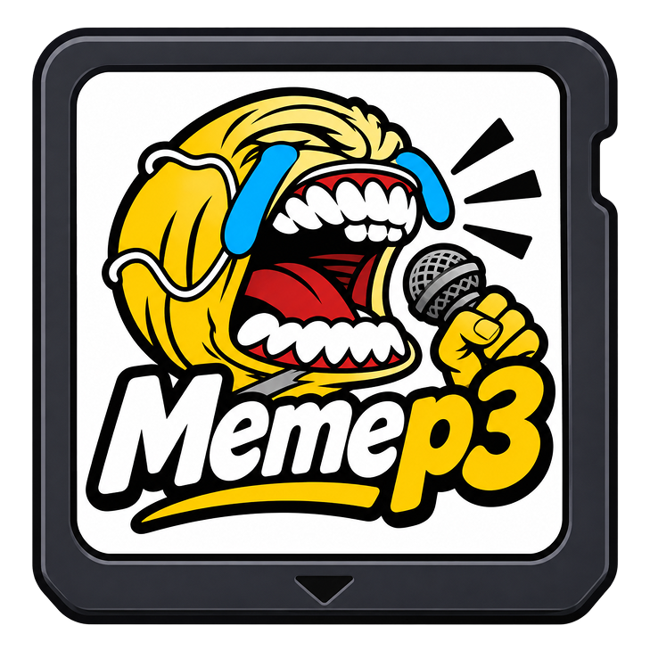
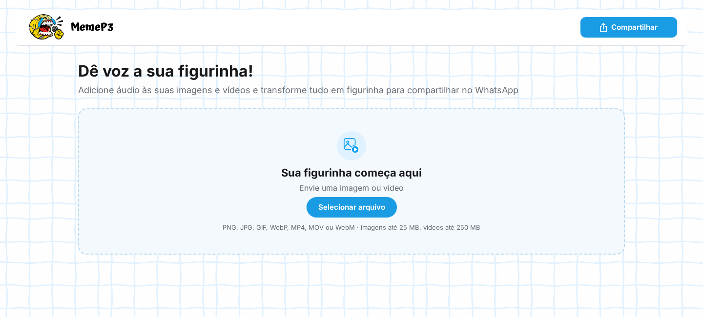
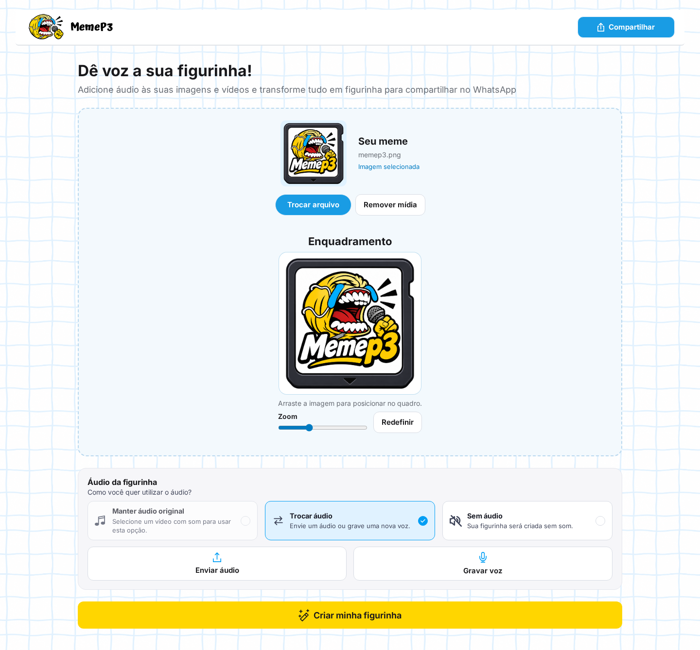

<div align="center">



# MemeP3

[](https://memep3.vercel.app/)
[](../../package.json)
[](../../package.json)
[](../../package.json)
[](#credits-and-license)

**Make WhatsApp stickers from images, GIFs, and videos. Trim, frame, and experiment with sound.**

[**Open the editor**](https://memep3.vercel.app/) · [Project wiki (Portuguese)](../README.md) · [Figma design](https://www.figma.com/design/WKxiDUIB4OApWJkoQd0gTw/memep3?node-id=0-1) · [Report an issue](https://github.com/erickpxd/memep3/issues)

[Português (BR)](../../README.md) · **English** · [Español](README.es.md) · [Français](README.fr.md)

</div>

[](https://memep3.vercel.app/)

<details>
<summary><strong>See the editor in action</strong></summary>



Screenshots from the [live site](https://memep3.vercel.app/): home screen and editor with the project logo loaded as an example. The interface is in Portuguese.

</details>

## What you can do

- Use PNG, JPG, and WebP images, animated GIFs, and MP4, MOV, and WebM videos, depending on browser codec support.
- Choose a clip up to 10 seconds long and adjust the square framing by dragging and resizing the media.
- Keep the video’s sound, import audio, record from your microphone, or create a silent sticker. Preview the clip and check that the sound lines up.
- Export static or animated WebP stickers, MP4 or WebM videos with audio, and `.memep3pack` files for the mobile apps.

## Where to use it

| Platform | What it offers |
| --- | --- |
| **Web** | Browser editor with local file processing. [Open MemeP3](https://memep3.vercel.app/) |
| **Chrome and Edge** | The same editor as an extension, with MyInstants audio import. [Load the extension locally](../desenvolvimento.md#extensão-do-chrome-e-edge) |
| **Android and iPhone** | Companion apps for adding silent sticker packs to WhatsApp. [Build the mobile apps](../desenvolvimento.md#app-android) |

## Create and save to WhatsApp

1. Select, paste, or drop a file into the editor.
2. Adjust the framing, clip, and audio. Check the preview and generate the result.
3. Choose **Baixar** (Download) to keep the file or **Salvar no WhatsApp** (Save to WhatsApp) to start the import flow for your device.

On Android, with the MemeP3 app installed, **Salvar no WhatsApp** downloads the WebP and opens the importer. The app puts three distinct stickers of the same type into a pack. On a computer or iPhone, the editor can bundle 3 to 30 stickers of the same type in a `.memep3pack` file for the mobile app. Confirm the addition in WhatsApp. [Import guide](../whatsapp.md)

To use audio, download the video and choose it in **Stickers → Create** in WhatsApp. Keeping the sound depends on whether the sound control is available for your account.

## Output formats

| Format | Use |
| --- | --- |
| **Static WebP** | Silent sticker, 512 × 512 px and up to 100 KB. |
| **Animated WebP** | Silent sticker, 512 × 512 px, up to 500 KB and 10 seconds. |
| **MP4 or WebM** | Video with the edited audio. The format depends on browser codec support. |
| **`.memep3pack`** | Local pack of static or animated stickers for import into MemeP3. |

## Development

Requires Node.js 22 or later.

```sh
git clone https://github.com/erickpxd/memep3.git
cd memep3
npm ci
npm run dev
```

Open [localhost:3000](http://localhost:3000). Run these commands to validate changes and create builds.

```sh
npm test
npm run typecheck
npm run build
```

The build outputs the static site to `web/out/` and the browser extension to `extension/dist/`. The wiki covers loading the extension, building the APK, and generating the iPhone project. [Development guide](../desenvolvimento.md)

## Repository layout

```text
memep3/
├── web/        Next.js website and public assets
├── extension/  Browser extension
├── mobile/     Android and iPhone apps
├── shared/     Shared editor, codecs, and tests
└── wiki/       Documentation and README translations
```

The editor uses Next.js and React with TypeScript, Mediabunny for reading and encoding media, and WebAssembly codecs on demand. The editor processes the files you add on your device. The extension contacts MyInstants when you request a link import. [Architecture](../arquitetura.md)

## Contributing

- To report a problem, include your platform, browser or app version, file format, and the steps to reproduce it. [Open an issue](https://github.com/erickpxd/memep3/issues/new)
- To propose a change, work in a fork, run the tests, and open a pull request with the expected behavior and what you verified. [Pull requests](https://github.com/erickpxd/memep3/pulls)
- When a workflow changes, update the wiki and the relevant README translations. [Wiki index](../README.md)

## Credits and license

StikSound inspired the project. [StikSound](https://github.com/SilverFeit/StikSound)

You may use the MemeP3 code under either the [MIT License](../../LICENSE-MIT) or the [Apache License 2.0](../../LICENSE-APACHE), at your option. Third-party dependencies are subject to their own licenses.
