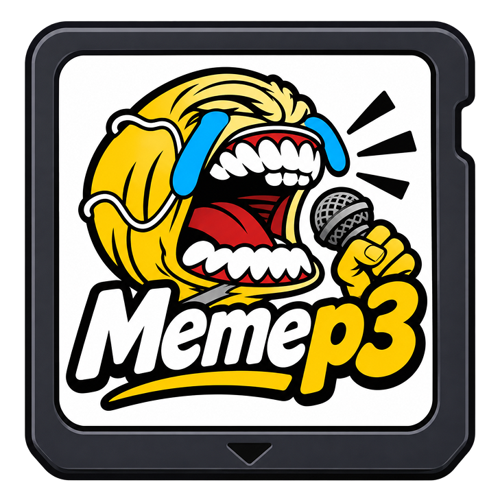
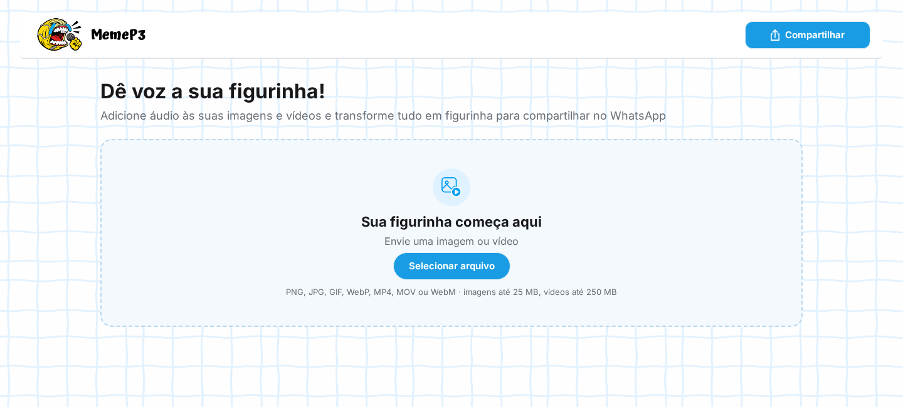
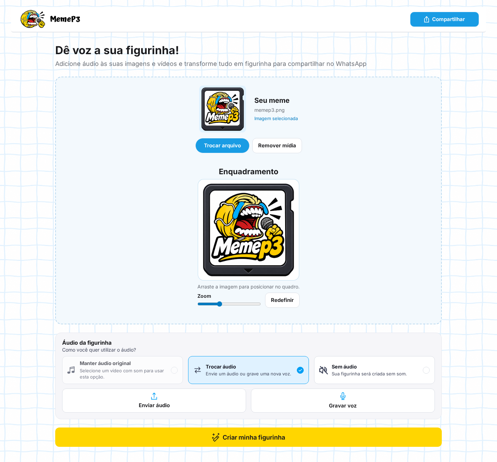

<div align="center">



# MemeP3

[](https://memep3.vercel.app/)
[](../../package.json)
[](../../package.json)
[](../../package.json)
[](#créditos-y-licencia)

**Crea stickers para WhatsApp a partir de imágenes, GIF y videos. Recorta, encuadra y experimenta con el sonido.**

[**Abrir el editor**](https://memep3.vercel.app/) · [Wiki en portugués](../README.md) · [Diseño en Figma](https://www.figma.com/design/WKxiDUIB4OApWJkoQd0gTw/memep3?node-id=0-1) · [Informar de un problema](https://github.com/erickpxd/memep3/issues)

[Português (BR)](../../README.md) · [English](README.en.md) · **Español** · [Français](README.fr.md)

</div>

[](https://memep3.vercel.app/)

<details>
<summary><strong>Ver el editor en acción</strong></summary>



Capturas del [sitio en producción](https://memep3.vercel.app/): pantalla inicial y editor con el logotipo del proyecto como ejemplo. La interfaz está en portugués.

</details>

## Qué puedes hacer

- Usa imágenes PNG, JPG y WebP, GIF animados y videos MP4, MOV y WebM, según los códecs disponibles en tu navegador.
- Elige un fragmento de hasta 10 segundos y ajusta el encuadre cuadrado arrastrando y cambiando el tamaño del contenido.
- Conserva el sonido del video, importa un audio, graba con el micrófono o crea un sticker sin sonido. Comprueba el recorte y la sincronización en la vista previa.
- Exporta stickers WebP estáticos o animados, videos con audio en MP4 o WebM y archivos `.memep3pack` para las aplicaciones móviles.

## Dónde usarlo

| Plataforma | Qué ofrece |
| --- | --- |
| **Web** | Editor en el navegador con procesamiento local de archivos. [Abrir MemeP3](https://memep3.vercel.app/) |
| **Chrome y Edge** | El mismo editor como extensión, con importación de audio desde MyInstants. [Cargar la extensión en local](../desenvolvimento.md#extensão-do-chrome-e-edge) |
| **Android y iPhone** | Aplicaciones complementarias para añadir paquetes sin sonido a WhatsApp. [Compilar las aplicaciones](../desenvolvimento.md#app-android) |

## Crear y guardar en WhatsApp

1. Selecciona, pega o arrastra un archivo al editor.
2. Ajusta el encuadre, el fragmento y el audio. Revisa la vista previa y genera el resultado.
3. Pulsa **Baixar** (Descargar) para guardar el archivo o **Salvar no WhatsApp** (Guardar en WhatsApp) para iniciar la importación en tu dispositivo.

En Android, con la aplicación MemeP3 instalada, **Salvar no WhatsApp** descarga el WebP y abre el importador. La aplicación reúne tres stickers distintos del mismo tipo en un paquete. En el ordenador o el iPhone, el editor puede agrupar de 3 a 30 stickers del mismo tipo en un archivo `.memep3pack` para abrirlo en la aplicación móvil. Confirma la importación en WhatsApp. [Guía de importación](../whatsapp.md)

Para usar el audio, descarga el video y selecciónalo en **Stickers → Crear** en WhatsApp. Podrás conservar el sonido si el control de audio está disponible en tu cuenta.

## Formatos de salida

| Formato | Uso |
| --- | --- |
| **WebP estático** | Sticker sin audio de 512 × 512 px y hasta 100 KB. |
| **WebP animado** | Sticker sin audio de 512 × 512 px, hasta 500 KB y 10 segundos. |
| **MP4 o WebM** | Video con el audio editado. El formato depende de los códecs del navegador. |
| **`.memep3pack`** | Paquete local de stickers estáticos o animados para importar en MemeP3. |

## Desarrollo

Se necesita Node.js 22 o posterior.

```sh
git clone https://github.com/erickpxd/memep3.git
cd memep3
npm ci
npm run dev
```

Abre [localhost:3000](http://localhost:3000). Ejecuta estos comandos para verificar los cambios y compilar el proyecto.

```sh
npm test
npm run typecheck
npm run build
```

La compilación genera el sitio estático en `web/out/` y la extensión en `extension/dist/`. La wiki explica cómo cargar la extensión, compilar el APK y generar el proyecto para iPhone. [Guía de desarrollo](../desenvolvimento.md)

## Estructura del repositorio

```text
memep3/
├── web/        Sitio Next.js y archivos públicos
├── extension/  Extensión del navegador
├── mobile/     Aplicaciones para Android y iPhone
├── shared/     Editor compartido, códecs y pruebas
└── wiki/       Documentación y traducciones del README
```

El editor usa Next.js y React con TypeScript, Mediabunny para leer y codificar archivos multimedia y códecs WebAssembly bajo demanda. El editor procesa los archivos en tu dispositivo. La extensión consulta MyInstants cuando solicitas importar un enlace. [Arquitectura](../arquitetura.md)

## Contribuir

- Para informar de un problema, indica la plataforma, el navegador o la versión de la aplicación, el formato del archivo y los pasos para reproducirlo. [Abrir una incidencia](https://github.com/erickpxd/memep3/issues/new)
- Para proponer un cambio, trabaja en un fork, ejecuta las pruebas y abre un pull request con el comportamiento esperado y lo que verificaste. [Pull requests](https://github.com/erickpxd/memep3/pulls)
- Si cambia un flujo, actualiza la wiki y las traducciones del README afectadas. [Índice de la wiki](../README.md)

## Créditos y licencia

StikSound inspiró el proyecto. [StikSound](https://github.com/SilverFeit/StikSound)

Puedes usar el código de MemeP3 bajo la licencia [MIT](../../LICENSE-MIT) o [Apache 2.0](../../LICENSE-APACHE), a tu elección. Las dependencias de terceros se rigen por sus propias licencias.
