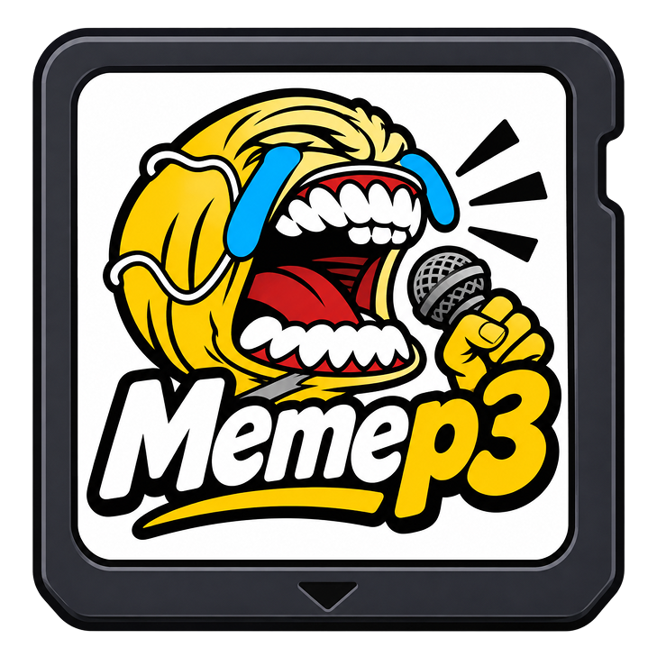
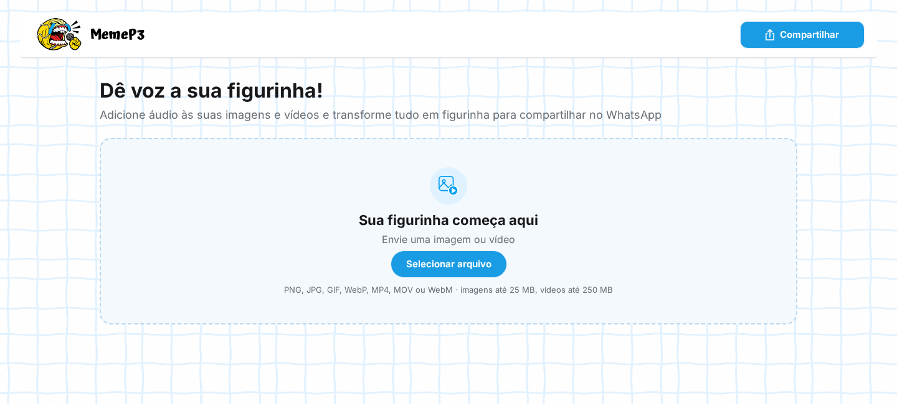
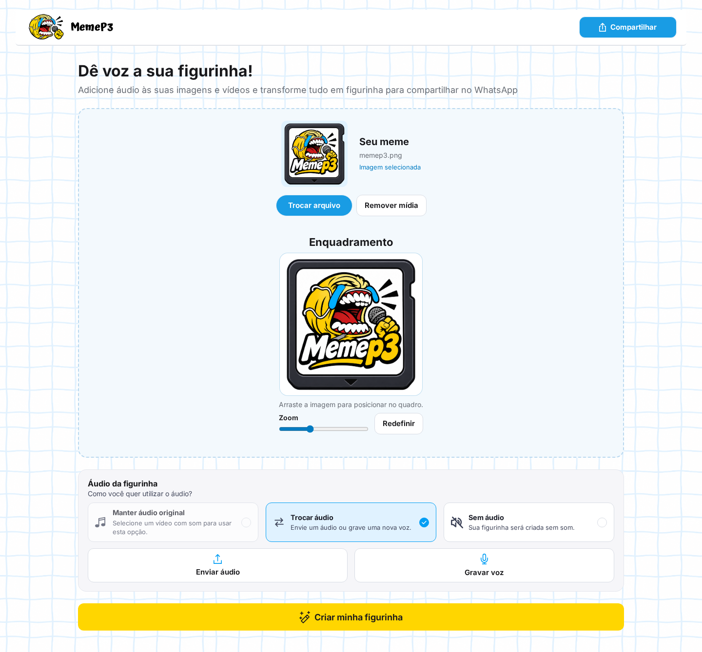

<div align="center">



# MemeP3

[](https://memep3.vercel.app/)
[](../../package.json)
[](../../package.json)
[](../../package.json)
[](#crédits-et-licence)

**Créez des stickers pour WhatsApp à partir d’images, de GIF et de vidéos. Découpez, cadrez et ajoutez du son.**

[**Ouvrir l’éditeur**](https://memep3.vercel.app/) · [Wiki en portugais](../README.md) · [Maquette Figma](https://www.figma.com/design/WKxiDUIB4OApWJkoQd0gTw/memep3?node-id=0-1) · [Signaler un problème](https://github.com/erickpxd/memep3/issues)

[Português (BR)](../../README.md) · [English](README.en.md) · [Español](README.es.md) · **Français**

</div>

[](https://memep3.vercel.app/)

<details>
<summary><strong>Voir l’éditeur en action</strong></summary>



Captures du [site en production](https://memep3.vercel.app/) : écran d’accueil et éditeur avec le logo du projet comme exemple. L’interface est en portugais.

</details>

## Ce que vous pouvez faire

- Utilisez des images PNG, JPG et WebP, des GIF animés et des vidéos MP4, MOV et WebM, selon les codecs pris en charge par votre navigateur.
- Sélectionnez un extrait de 10 secondes maximum, puis ajustez le cadrage carré en déplaçant et en redimensionnant le média.
- Conservez le son de la vidéo, importez un fichier audio, enregistrez au microphone ou créez un sticker sans son. Vérifiez le découpage et la synchronisation dans l’aperçu.
- Exportez des stickers WebP statiques ou animés, des vidéos MP4 ou WebM avec du son, et des fichiers `.memep3pack` pour les applications mobiles.

## Où utiliser MemeP3

| Plateforme | Fonctionnalités |
| --- | --- |
| **Web** | Éditeur dans le navigateur avec traitement local des fichiers. [Ouvrir MemeP3](https://memep3.vercel.app/) |
| **Chrome et Edge** | Le même éditeur sous forme d’extension, avec importation audio depuis MyInstants. [Charger l’extension localement](../desenvolvimento.md#extensão-do-chrome-e-edge) |
| **Android et iPhone** | Applications complémentaires pour ajouter des packs de stickers sans son à WhatsApp. [Compiler les applications](../desenvolvimento.md#app-android) |

## Créer et enregistrer dans WhatsApp

1. Sélectionnez, collez ou déposez un fichier dans l’éditeur.
2. Réglez le cadrage, l’extrait et le son. Vérifiez l’aperçu, puis générez le résultat.
3. Choisissez **Baixar** (Télécharger) pour conserver le fichier ou **Salvar no WhatsApp** (Enregistrer dans WhatsApp) pour lancer l’importation sur votre appareil.

Sur Android, si l’application MemeP3 est installée, **Salvar no WhatsApp** télécharge le WebP et ouvre l’outil d’importation. L’application regroupe trois stickers distincts du même type dans un pack. Sur ordinateur ou sur iPhone, l’éditeur peut regrouper de 3 à 30 stickers du même type dans un fichier `.memep3pack` à ouvrir dans l’application mobile. Confirmez ensuite l’ajout dans WhatsApp. [Guide d’importation](../whatsapp.md)

Pour utiliser le son, téléchargez la vidéo, puis sélectionnez-la via **Stickers → Créer** dans WhatsApp. Vous pouvez conserver le son si la commande audio est disponible sur votre compte.

## Formats de sortie

| Format | Utilisation |
| --- | --- |
| **WebP statique** | Sticker sans son de 512 × 512 px et de 100 Ko maximum. |
| **WebP animé** | Sticker sans son de 512 × 512 px, de 500 Ko maximum et de 10 secondes maximum. |
| **MP4 ou WebM** | Vidéo avec le son modifié. Le format dépend des codecs disponibles dans le navigateur. |
| **`.memep3pack`** | Pack local de stickers statiques ou animés à importer dans MemeP3. |

## Développement

Node.js 22 ou une version ultérieure est nécessaire.

```sh
git clone https://github.com/erickpxd/memep3.git
cd memep3
npm ci
npm run dev
```

Ouvrez [localhost:3000](http://localhost:3000). Exécutez les commandes suivantes pour vérifier et compiler le projet.

```sh
npm test
npm run typecheck
npm run build
```

La compilation génère le site statique dans `web/out/` et l’extension dans `extension/dist/`. Le wiki explique comment charger l’extension, compiler l’APK et générer le projet iPhone. [Guide de développement](../desenvolvimento.md)

## Organisation du dépôt

```text
memep3/
├── web/        Site Next.js et ressources publiques
├── extension/  Extension de navigateur
├── mobile/     Applications Android et iPhone
├── shared/     Éditeur partagé, codecs et tests
└── wiki/       Documentation et traductions du README
```

L’éditeur utilise Next.js et React avec TypeScript, Mediabunny pour la lecture et l’encodage des médias, et des codecs WebAssembly chargés à la demande. Les fichiers ajoutés à l’éditeur sont traités sur votre appareil. L’extension contacte MyInstants lorsque vous demandez l’importation d’un lien. [Architecture](../arquitetura.md)

## Contribuer

- Pour signaler un problème, indiquez la plateforme, le navigateur ou la version de l’application, le format du fichier et les étapes pour reproduire le problème. [Ouvrir une issue](https://github.com/erickpxd/memep3/issues/new)
- Pour proposer une modification, travaillez dans un fork, lancez les tests et ouvrez une pull request en décrivant le comportement attendu et vos vérifications. [Pull requests](https://github.com/erickpxd/memep3/pulls)
- Si une fonctionnalité change, mettez à jour le wiki et les traductions du README concernées. [Index du wiki](../README.md)

## Crédits et licence

StikSound a inspiré le projet. [StikSound](https://github.com/SilverFeit/StikSound)

Vous pouvez utiliser le code de MemeP3 sous licence [MIT](../../LICENSE-MIT) ou [Apache 2.0](../../LICENSE-APACHE), au choix. Les dépendances tierces sont soumises à leurs propres licences.
